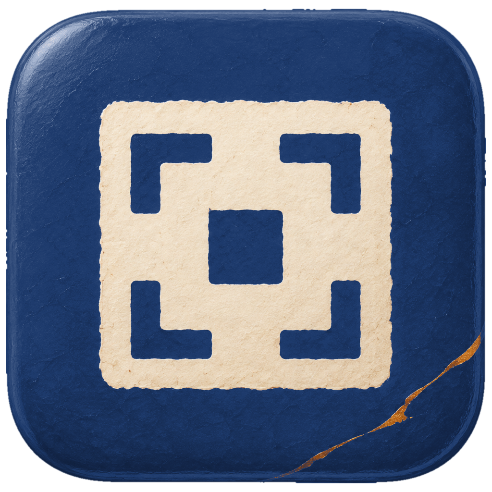

<div align="center">
    <h1>UTSUSHIE</h1>
    
    <h3>写絵</h3>
    <p>画面をWebP画像・MP4動画で撮り、注釈や切り出しを加えて、すぐ貼り付け・ドラッグで共有できるmacOSアプリ</p>
    <p>
        <a href="https://github.com/tadashi-aikawa/utsushie/releases/latest"></a>
        <a href="https://github.com/tadashi-aikawa/utsushie/actions/workflows/ci.yml"></a>
        <a href="https://github.com/tadashi-aikawa/utsushie/blob/main/LICENSE"></a>
    </p>
</div>

---

- **撮影**: クリックでウィンドウ、ドラッグで範囲を撮る。画像は見た目の大きさ(1x)のWebP
- **録画**: 範囲やウィンドウをMP4で録る
- **共有**: 保存と同時にクリップボードへ載せる。画面右下のカードからドラッグでも渡せる
- **注釈**: 枠・スポットライト・文字・番号・矢印・モザイク。AIで公開しないほうがよい箇所を探してモザイクにもできる
- **動画の編集**: 不要な範囲を切り、早送り・暗転・ディゾルブでつなぐ。録画から静止画も選べる
- **撮影の一覧**: 保存した画像・動画を一覧で探し、コピー・ドラッグ・編集・削除する

## 対応環境

- macOS 26以降

## インストール

```sh
brew install --cask tadashi-aikawa/tap/utsushie
```

アップデートは `brew upgrade --cask utsushie` です。

手動で入れる場合は、[Releases](https://github.com/tadashi-aikawa/utsushie/releases/latest) から `UTSUSHIE-<version>.zip` をダウンロード・展開し、`UTSUSHIE.app` を `/Applications` に移動します。

> [!NOTE]
> UTSUSHIEは自己署名の未公証アプリです。初回起動がブロックされた場合は、システム設定 → プライバシーとセキュリティ →「このまま開く」で許可してください。

### 権限

- **画面収録**: 最初の撮影で案内が出ます。許可したらUTSUSHIEを再起動してください
- **アクセシビリティ**: 要素選択のEと、Chromeのページ表示領域を撮るCで必要です
- **マイク**: マイクの声を入れて録画するときだけ必要です。最初の録画で案内が出ます

## 撮る

ホットキー(既定は⌘⇧2)を押すと、範囲を選べる状態になります。

画像は、ホットキーを押した瞬間の画面を止めて、その上で選びます。ホバーで出たポップアップも、消えずに撮れます。

- ウィンドウ: クリックすると、止めた画面からウィンドウの枠で切り出します。手前に重なった窓やポップアップも、見えているとおりに写ります。
- 動画: 止めません。Tabで動画へ切り替えると、今の画面に戻ります。

UTSUSHIE自身の編集画面や撮影の一覧も撮影・録画できます。

| 操作 | 動作 |
| --- | --- |
| クリック | カーソルの下のウィンドウを撮る |
| ⇧+クリック | カーソルの下のディスプレイ全体を撮る |
| ドラッグ | 選んだ範囲を撮る |
| Enter | 要素選択中は光っている要素、それ以外は前回と同じ範囲を撮る |
| ホットキーをもう一度 | 前回と同じ範囲を撮る |
| ⌥を押しながら前回範囲の枠をドラッグ | 前回範囲を動かす |
| C | Chromeで表示中のページ部分だけを撮る |
| E | アプリの要素選択を切り替える。枠が出た要素をクリックで撮る |
| ↑ / ↓ | 要素選択中、親の範囲へ広げる / 辿った子へ戻る |
| Tab | 画像と動画を切り替える |
| R | 画像・動画の解像度を1x(見た目の大きさ)と2x(ディスプレイの画素)で切り替える。その回だけ |
| A | 動画のとき、録る音を切り替える |
| Esc | やめる |

⇧を押している間は、カーソルの下のディスプレイ全体が明るくなります。

⇧を押したままドラッグすると、通常の範囲選択になります。

要素選択は試作です。Chrome以外のアプリやブラウザのツールバーも対象です。

- 対象: アクセシビリティで取得できる、ウィンドウ内の見えている要素です。
- 制約: 選べる細かさはアプリ次第です。独自描画の部分を選べない場合や、余白で大きな親の枠になる場合があります。WebページでもDOMの要素とは一致しません。
- 範囲: カーソルのあるディスプレイ内だけを撮ります。他の窓に隠れている要素は選びません。
- 親の選択: ↑で広げた枠は、カーソルが枠内にいる間は保ちます。
- カーソル: 要素選択中は矢印です。読み取り中もカーソルと下端の操作案内を保ちます。
- 戻る: Eをもう一度押すと通常の選択へ戻ります。範囲ドラッグ・⇧での画面撮影・⌥での前回枠移動は、戻ってから行います。
- 動画: 選んだ位置の固定範囲を録画します。要素の移動やスクロールには追従しません。

動画では、対象を選ぶと録画が始まります。

- 2xのときは60fpsで録画します。
- 停止: ホットキーをもう一度押すか、メニューバーの「■ 時間」の札をクリックします。
- 範囲: ドラッグを始めたディスプレイの端で止まります。
- 音: 既定では録りません。設定の `[video] audio` で既定を決め、範囲を選ぶ間にAでその回だけ切り替えます。
    - 順番: なし → アプリ → マイク → 両方
    - アプリ: UTSUSHIE以外のアプリの音です。ウィンドウを録るときは、そのウィンドウのアプリの音だけです。
    - 両方: アプリの音とマイクの声を1つの音声へ混ぜて保存します。

## 共有する

撮った画像・動画は `~/Pictures/UTSUSHIE/` に保存され、同時にクリップボードへ載ります。そのまま⌘Vで貼り付けられます。

画面右下のカードからは、ファイルをドラッグして渡せます。最新のカードでは、カーソルを乗せなくても次のキーが使えます。

| キー | 動作 |
| --- | --- |
| ⏎ / E | 画像に注釈を入れる・動画を編集する |
| S | 別の場所にも保存する |
| O | Finderで表示する |
| X / Esc | カードを閉じる |

## 撮影の一覧

メニューバーの「撮影の一覧を開く」で、保存フォルダの画像・動画を新しい順に一覧できます。

| キー | 動作 |
| --- | --- |
| ←↓↑→ / HJKL | 選択を移動する |
| ⇧+矢印 / ⇧+HJKL / ⇧+クリック | 範囲を選ぶ |
| ⌘+クリック / ⌘A | 選択へ足す・外す / すべて選ぶ |
| ⏎ / E / ダブルクリック | 編集を開く |
| S | 別の場所にも保存する |
| O | Finderで表示する |
| ⌘C | 選んだ項目をコピーする |
| X → X | 選んだ項目をゴミ箱へ移す |
| Space | クイックルックを開閉する |
| Q / Esc / ⌘W | クイックルックか一覧を閉じる |

選んだ項目は他のアプリへまとめてドラッグできます。既定はコピーで、⌘を押しながら落とすと移動します。

## 画像に注釈を入れる

画像カードのEnterで、注釈の編集画面が開きます。

| ツール | キー | 注釈を置く操作 |
| --- | --- | --- |
| 選択 | V | 注釈の移動はこのツールで行う。空白からドラッグして矩形にかかる注釈を選ぶ |
| 枠 | R | ドラッグ |
| スポットライト | S | 明るく残したい範囲をドラッグ |
| 文字 | T | クリックして入力。指したい点からドラッグすると引き出し線付き |
| 番号 | N | クリックで番号。指したい点からドラッグすると引き出し線付き |
| 矢印 | A | 始点から終点へドラッグ |
| 直線 | L | 始点から終点へドラッグ |
| 蛍光ペン | P | フリーハンドでドラッグ。⇧を押して描き始めると水平か垂直の直線。1〜4で色、C / ⇧Cで次・前の色、Dで暗い地向け |
| モザイク | M | 隠したい範囲をドラッグ |
| AIで隠す | H | 隠したほうがよい箇所を探してモザイクを置く |

| キー | 動作 |
| --- | --- |
| Delete | 選んだ注釈を消す |
| Enter / ⌘↩ / ⌘W | 保存して閉じる。文字入力中のEnterは文字を確定する |
| ⇧Enter | 文字入力中に改行する |
| Esc | 選択解除。何も選んでいなければ保存して閉じる。文字入力中は確定、AI探索中は中止 |
| ⇧+クリック | 選択へ足し引きする |
| 1〜8 | 枠・矢印・直線・文字・番号・スポットの色を朱・橙・緑・藍・紫・桃・墨・白から選ぶ。C / ⇧Cで次・前の色 |
| 1〜4 / D | 蛍光ペンの色を黄・水色・桃・緑から選ぶ。C / ⇧Cで次・前の色。Dで暗い地向けを切り替える |
| [ / ] | 注釈の大きさを1段小さく / 大きくする。文字入力中は文字として入力する |
| 選択ツールでドラッグ / ⇧+ドラッグ | 矩形にかかる注釈を複数選択する / 今の選択に足す |
| ⌘C / ⌘V / ⌘D | 注釈をコピー / 貼り付け / 複製する |
| ⇧+ドラッグ | 移動・蛍光ペンを水平・垂直、矢印・直線を45°刻み、枠・スポット・モザイクの作成と角のリサイズを正方形にする |
| ⌘Z / ⇧⌘Z | 取り消し・やり直し |
| ピンチ / ⌘+スクロール / ⌘+ / ⌘- | 拡大縮小 |
| ⌘0 / ⌘1 | 全体を表示 / 100%で表示 |
| 2本指スクロール / スペース+ドラッグ | 表示を移動 |

- 文字・番号・枠・直線・矢印は画像の外へ出せます。
  - 結果: 出した分だけ余白が広がります。
- 枠とスポットを画像の端へ寄せても、線と縁が画像の中に収まります。
- スポットは画像の外からドラッグして描き始められます。
  - 配置: 押した点を画像の内側へ寄せます。
- 複数選択した注釈はまとめて移動・削除・コピーできます。
  - 制限: リサイズと端点変更は1件選択のときだけです。
- 蛍光ペンの色と「暗い地」はツールバー下段でも選べます。
  - 濃さ: 明るい地は90%、暗い地は75%です。
  - 対象: 選択中の蛍光ペン全件へ適用します。
  - 未選択: 次に描く線の設定を変えます。
  - 記憶: 最後に使った設定はアプリを終了するまで保ちます。
- 枠・矢印・直線・文字・番号・スポットの色はツールバー下段でも選べます。
  - 対象: 選択中の対象注釈全件へ適用します。
  - 未選択: 次に描く注釈の色を変えます。
  - 記憶: 最後に使った色はアプリを終了するまで保ちます。
  - 文字入力中: 数字キーは文字として入力します。
    - 操作: 色を変えるときは文字を確定してください。
- 大きさは色の右の5つの点でも選べます。
  - 段階: ×0.6・×0.8・×1・×1.4・×2。既定は×1です。
  - 対象: 文字・番号の大きさと、枠・スポット・矢印・直線・蛍光ペンの線の太さです。
  - 選択中: モザイク以外の選んだ注釈へまとめて適用します。
  - 未選択: 次に描く注釈の大きさを変えます。
  - 記憶: ツールごとに最後に使った大きさをアプリ終了まで保ちます。
    - 切り替え: 注釈の選択を解除し、そのツールの前回の大きさを表示します。
- 注釈のコピーは開いている編集画面内で使えます。
  - 貼り付け: 右下へ少しずらし、番号は次の連番にします。続けて貼るとさらにずれます。
- 保存すると元のWebPを置き換え、カードとクリップボードも更新します。

### AIで隠す

`[privacy] ai = true` で有効になります。Claude Codeをインストールし、`claude auth login` を済ませてください。

- Claudeへは認識した文字だけを送ります。画像と位置は送りません。顔はMac内で検出します。
- 見落としはあります。公開前に画像を確認してください。

## 動画を編集する

動画カードのEで、動画の編集画面が開きます。

- 序盤・終盤は時間軸の藍の枠のつまみを引いて、途中は帯をドラッグして⌫で切ります。
- つまみを引いている間は、その端の位置のコマをプレビューします。
    - 終了: 離すと元の再生位置へ戻ります。
- 途中の切った範囲は、文字をクリックしてつなぎ方を選べます。
    - そのまま: 切った範囲を飛ばす(既定)
    - 早送り: 切った範囲を2〜100倍で見せる
    - 暗転: 黒を挟んで切り替える
    - ディゾルブ: 前後のコマを重ねて切り替える
- 音のある動画では、音もつなぎ方に合わせます。
    - そのまま: 前後の音をつなぐ
    - 早送り: その間は音を出さない
    - 暗転: 音も絞ってから戻す
    - ディゾルブ: 前後の音を重ねて入れ替える
- ⏎で今のコマを静止画として選ぶと、完了時にWebPで保存します。

| キー | 動作 |
| --- | --- |
| Space | 再生・停止 |
| ← / → | 前・次の1コマへ移動 |
| ⇧← / ⇧→ | 1秒戻る・進む |
| ⌘← / ⌘→ | 先頭・末尾へ移動 |
| I / O | 残す範囲の始め・終わりを再生位置に合わせる |
| ⌫ | 選んだ範囲を切る |
| ⏎ | 今のコマを静止画として選ぶ |
| ⌘Z / ⇧⌘Z | 取り消し・やり直し |
| ⌘↩ | 完了 |
| Q / ⌘W | 破棄する。変更があれば2回押す |

## 設定

メニューの「設定ファイルを開く」で `~/.config/utsushie/config.toml` を開きます。変更は次の撮影から反映されます。

```toml
outputDir = "~/Pictures/UTSUSHIE"

[hotkey]
keyCode = 19                     # 物理キーの番号。19は「2」
modifiers = ["command", "shift"] # ⌘・⌥・⌃のいずれかを含める

# 任意。一覧をホットキーで開く場合だけコメントを外す
# [libraryHotkey]
# keyCode = 37                    # 物理キーL。⌘⇧L
# modifiers = ["command", "shift"]

[webp]
downscale = true                 # 見た目の大きさ(1x)に縮小する既定。範囲選択のRでその回だけ切り替え
quality = 80                     # 0〜100
lossless = false                 # trueなら可逆圧縮(qualityは使わない)

[video]
fps = 30                         # 1〜60
downscale = true                 # 見た目の大きさ(1x)に縮小する既定。範囲選択のRでその回だけ切り替え
showsCursor = true               # カーソルを写す
audio = "none"                   # 録る音。none / system: アプリ / mic: マイク / both: 両方

[clipboard]
mode = "both"                    # 画像のコピー形式。both: ファイルとデータ / file / data。動画は常にファイル

[thumbnail]
seconds = 5                      # カードを出しておく秒数

[privacy]
ai = false                       # trueでAIで隠すを有効にする
claude = ""                      # Claude Codeのパス。空なら自動で探す
model = "sonnet"
effort = "low"                   # low / medium / high
```

不正な値はその項目だけ既定値に戻り、メニューに警告が出ます。

## 開発

```sh
swift build
swift test
./scripts/make-app.sh release && open .build/UTSUSHIE.app
```

構成・設計の判断・リリース方法は [CLAUDE.md](CLAUDE.md) を参照してください。

## ライセンス

[MIT](LICENSE)
